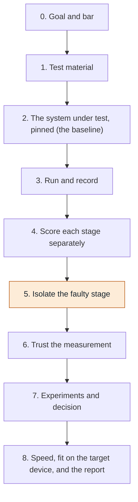

# rag-benchmark

**English** | [繁體中文](README.zh-TW.md)

A hands-on project for testing a RAG (retrieval-augmented generation) system from start to finish.

This README lists the 9 steps of the benchmark in order, and each step opens into smaller steps. A RAG system (retrieval-augmented generation) is a program that finds pieces of text in documents and has a language model answer from them. A benchmark is a fixed test that measures how well and how fast it does that. This one is in Japanese, uses local models only, and treats speed as equal to quality.

The plan in one line: run everything at default settings first, then find out which part of the system causes the problems, then decide what to fix.

## The exam analogy

| In the analogy | In the benchmark |
|---|---|
| The student | the RAG system |
| The textbook | the documents |
| The exam | the questions |
| The answer key | the labelled correct answers |
| Finding the page | retrieval: the system looks up the right text |
| Writing the answer | the answer step: the language model writes |
| The marker | the judge: a person or a model that grades answers |
| The stopwatch | the timers that measure speed |

## The 9 steps in order

Step 5 is highlighted because it is the step that finds out which stage of the system is causing the wrong answers.

## Each step, broken into smaller steps

Select a step to open it.

<b>0. Goal and bar</b> - Before anything runs, write down in numbers what "good enough" means.

**Exam analogy:** mark the finish line before the race. Decide the pass mark before the student sits the exam.

**0.1 Write the quality numbers**

Two numbers. The minimum retrieval hit rate: how often the system must find the right piece of text. The minimum share of correct answers: how many answers must match the answer key.

**0.2 Write the speed and size numbers**

The maximum added delay in milliseconds: how much extra waiting the RAG system may add. The memory limit: how much memory it may use. The target is a small edge device with limited memory, and that memory is shared with other programs.

**0.3 Write the hit-rate number at the right moment**

Write the hit-rate threshold after the documents are chosen (step 1) but before any run (step 3). That way the number fits the material, but no result can influence it.

**0.4 Freeze the bar**

Frozen means it does not change. If it must change later, that is a new version with a stated reason.

**Output:** a frozen one-page bar.

<b>1. Test material</b> - Prepare the fixed documents, the questions and the correct answers.

**Exam analogy:** choose the textbook, write the exam, and write the answer key.

**1.1 Fix the documents**

Choose the Japanese documents and store a **checksum** for them. A checksum is a short fingerprint of a file. If the file changes, the fingerprint changes, so anyone can see the documents are still the same.

**1.2 Write questions with the answer and its exact position**

Each question gets the correct answer and the exact position in the document where that answer is written. The position matters because of **chunking**, which means cutting documents into pieces. If the cutting changes later, a label tied to a position still works.

**1.3 Add a few questions with no answer in the documents**

These show whether the system admits "this is not in the documents" or makes something up.

**1.4 Add some harder question types**

- The answer is spread over several places in the documents.
- The question uses different wording from the document.

**1.5 Split the questions into two sets**

- **Dev set:** used for tuning, which means trying changes and looking at the results.
- **Held-out set:** used once at the end and kept private. Only its checksum is public.

**1.6 Freeze the files and check the labels**

**Output:** frozen files, plus a script that checks every answer text really sits at its labelled position.

**Note:** about 30 questions is a small sample. A hit rate from it is only accurate to roughly plus or minus 15 percentage points.

<b>2. The system under test, pinned (the baseline)</b> - Write down exactly which system is being tested, then run it with default settings.

**Exam analogy:** the baseline is the student before any tutoring.

**2.1 Name the stages of the system**

A stage is one part of the system that does one job. There are five, in this order:

- Cut the documents into chunks (pieces).
- Turn the chunks into vectors. This is called **embedding**. A vector is a list of numbers that stands for the meaning of a chunk.
- Find candidate chunks for a question.
- **Rerank** them: reorder them so the best come first.
- Write the answer with the language model.

**2.2 Pin every model and setting**

Pinned means fixed to an exact version. Put every model and setting in one config file (a settings file) per run.

**Output:** one config file per run.

**2.3 Define the baseline**

The **baseline** is the run with everything at a sensible default. Every later change is compared to it.

<b>3. Run and record</b> - Ask every question and save everything the system did.

**Exam analogy:** the student sits the exam. Keep the answer sheet, the pages the student opened, and the stopwatch times.

**3.1 Record the retrieved chunks**

For each question, save the chunks the system found, with their rank (position in the result list) and their score.

**3.2 Record the final answer**

Save the answer text for each question.

**3.3 Record a timer per stage**

Save how long each stage took, not just the total.

**3.4 Record checksums of the config and the data**

These fingerprints prove which settings and which files a result came from.

**3.5 Keep the raw outputs**

**Output:** raw output files, so any run can be re-scored later without running it again.

**3.6 Do the quick memory check now**

This belongs to step 8 but is done early. See 8.3.

<b>4. Score each stage separately</b> - Give a separate score to finding, reranking, answering and speed.

**Exam analogy:** mark "did the student open the right page" separately from "did the student write the right answer", and read the stopwatch separately too.

**4.1 Score FIND**

This needs no judge. Compare what was found with the labelled position from step 1. The letter k means how many top results are looked at.

- **Hit rate@k:** does the right chunk appear anywhere in the top k results? Example: the right chunk is in the top 3 for 28 of 30 questions = 93%.
- **Recall@k:** how much of the needed text was found. It differs from hit rate only when an answer needs several chunks.
- **MRR:** how high the first right chunk is. Rank 1 scores 1, rank 2 scores 0.5, rank 3 scores 0.33. Then take the average over all questions.
- **Precision@k:** how much of what came back is useful. Example: 1 right chunk among 3 returned = 33%.

**4.2 Score RERANK**

Measure MRR and precision@k before reranking and again after reranking. The difference shows what reranking adds.

**4.3 Score ANSWER**

- **Correctness:** the answer matches the answer key.
- **Faithfulness:** the answer is supported by the retrieved text. This catches made-up answers.
- **Refusal rate:** the system says "not in the documents" on the no-answer questions.

Grade these by hand first. Use a judge model later. A judge model is a local language model that grades answers in place of a person.

**4.4 Score SPEED**

Do a warm-up run first (one run that is not counted, so everything is loaded). Then measure:

- Time per stage, as the **median** (the middle value) and the **p95** (the slowest 5%).
- **First-word delay:** the wait until the first word of the answer appears.
- **Memory peak:** the most memory used at any moment.

**4.5 Name the machine on every timing**

Numbers from a laptop and from the target device are not comparable.

<b>5. Isolate the faulty stage</b> - Find out which stage of the system is causing the wrong answers.

**Exam analogy:** give the student the same exam three ways: with no textbook, with the right page already open, and normally. The differences show whether the problem is finding the page or writing the answer.

**5.1 Run (a): closed-book**

No retrieval at all. The model answers alone. This shows what the model already knows without the documents.

**5.2 Run (b): oracle**

Hand the model the correct text directly, using the labels from step 1. This shows the best the answer step can do.

**5.3 Run (c): full system**

The normal system, with all stages. Use the SAME questions in all three runs.

**5.4 Read the gaps between the three runs**

- Full system far below oracle: retrieval (find or rerank) is losing the points.
- Oracle itself is low: the answer model or its prompt is the limit. The prompt is the instruction text given to the model.
- Full system not above closed-book: retrieval adds nothing.

**5.5 Check each failed question**

For every wrong answer, ask one thing: was the right text retrieved or not?

**5.6 Write the note**

**Output:** a one-page note naming the weakest stage.

<b>6. Trust the measurement</b> - Check that the scores themselves can be believed.

**Exam analogy:** check the marker before trusting the marks.

**6.1 Two people label the same 50 answers, blind**

Blind means without seeing the judge's score.

**6.2 Compare people to people first**

See how often the two people agree with each other.

**6.3 Then compare the judge to the people**

A judge that disagrees with people must not decide anything.

**6.4 Check repeatability**

Rerun a sample of questions, reloading the model between runs. This shows how much the scores move by chance.

**6.5 Report ranges, not single numbers**

The sample is small (see the note in 1.6), so a single number looks more exact than it is.

<b>7. Experiments and decision</b> - Change one thing at a time, compare with the baseline, then decide.

**Exam analogy:** try one kind of tutoring at a time, then give the same exam again and compare with the first result.

**7.1 Change ONE thing and rerun**

Compare the new run to the baseline, using the bar from step 0.

**7.2 Use one target metric plus guardrails**

The target metric is the one number the change should improve. Guardrails are numbers that must not get worse: recall and delay.

**7.3 Use a paired bootstrap for close calls**

A **paired bootstrap** resamples the per-question scores many times. It shows whether a small difference is real or just chance.

**7.4 Run the held-out set once**

Only before deciding to ship.

**7.5 Keep a results table**

**Output:** a results table with one row per run.

<b>8. Speed, fit on the target device, and the report</b> - Check it runs fast enough and fits in memory on the real target device, then write it up.

**Exam analogy:** the student must pass in the real exam room, with the real stopwatch, not only at home.

**8.1 Run the full chain on the target device**

Run it next to the other programs the device must run at the same time.

**8.2 Check against the step 0 bar**

Check memory against the limit and delay against the bar.

**8.3 Do a quick memory check early (during step 3)**

The embedding model and the index could rule out a design. The index is the stored vectors that the system searches.

**8.4 Write the report**

**Output:** a one-page report with five parts: baseline, weakest stage, what changed, verdict, limits.

## Glossary of metric names

| Name | Meaning |
|---|---|
| Hit rate@k | Does the right chunk appear anywhere in the top k results? Example: right chunk in the top 3 for 28 of 30 questions = 93%. |
| Recall@k | How much of the needed text was found in the top k results. Differs from hit rate only when an answer needs several chunks. |
| MRR | How high the first right chunk is. Rank 1 scores 1, rank 2 scores 0.5, rank 3 scores 0.33, averaged over all questions. |
| Precision@k | How much of what came back is useful. Example: 1 right chunk among 3 returned = 33%. |
| Correctness | The answer matches the answer key. |
| Faithfulness | The answer is supported by the retrieved text. Catches made-up answers. |
| Refusal rate | How often the system says "not in the documents" on the questions that have no answer in the documents. |
| Median | The middle value of the timings. |
| p95 | The slowest 5% of the timings. |
| First-word delay | The wait until the first word of the answer appears. |
| Memory peak | The most memory used at any moment during a run. |

## How we work

- Changes go through pull requests. Nothing goes straight to `main`.
- Every pull request is reviewed by a contributor other than its author.
- One change per pull request, with the benchmark numbers (quality and speed) in the description when the change affects them.
- Pin every model to an exact version. A rolling alias can change the judge without notice.
- Never commit API keys, `.env` files or machine-specific paths.
- Keep the held-out question set out of the repository. Only its checksum is committed.

## Status

This repository is at the start. Progress on each step is tracked in [docs/roadmap.md](docs/roadmap.md).
