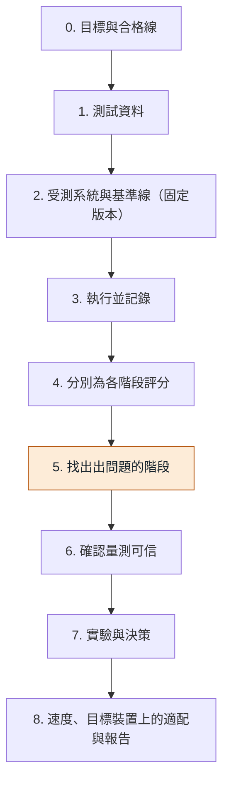

# rag-benchmark

[English](README.md) | **繁體中文**

一個從頭到尾測試 RAG（檢索增強生成）系統的實作專案。

本文件依序列出基準測試的 9 個步驟，每個步驟都能展開成更小的步驟。RAG 系統（檢索增強生成）是一種程式：它從文件中找出幾段文字，再讓語言模型根據這些文字回答。基準測試是一份固定的測驗，用來衡量它做得好不好、快不快。這一份使用日文、只用本機模型，並且把速度和品質看得一樣重要。

整體計畫一句話：先全部用預設設定跑一遍，再找出系統的哪個部分造成問題，最後決定要修什麼。

## 考試比喻

| 比喻中 | 在基準測試中 |
|---|---|
| 學生 | RAG 系統 |
| 教科書 | 文件 |
| 考試 | 問題 |
| 解答 | 已標註的正確答案 |
| 找出頁面 | 檢索：系統查找正確的文字 |
| 寫出答案 | 回答步驟：語言模型負責寫答案 |
| 評分者 | 評審：負責批改答案的人或模型 |
| 碼表 | 測量速度的計時器 |

## 9 個步驟的順序

步驟 5 以顏色標出，因為它是用來找出系統哪個階段造成錯誤答案的步驟。

## 每個步驟拆成更小的步驟

點選步驟即可展開。

<b>0. 目標與合格線</b> - 在開始執行任何東西之前，先用數字寫下「夠好」是什麼意思。

**考試比喻：**賽跑前先畫好終點線。學生進考場之前，先決定好及格分數。

**0.1 寫下品質數字**

兩個數字。檢索命中率（Hit rate）的下限：系統必須多常找到正確的那段文字。正確率的下限：有多少答案必須和解答相符。

**0.2 寫下速度與大小的數字**

最大額外延遲（以毫秒計）：RAG 系統最多可以多讓人等多久。記憶體上限：它最多可以用多少記憶體。目標是一台記憶體有限的小型邊緣裝置，而且這份記憶體要和其他程式共用。

**0.3 在對的時間點寫下命中率數字**

在選好文件之後（步驟 1）、但在任何一次執行之前（步驟 3），寫下命中率門檻。這樣數字符合測試資料，又不會受到任何結果影響。

**0.4 凍結合格線**

凍結的意思是不再更動。如果之後一定要改，就當成新版本，並寫明理由。

**產出：**一頁凍結後的合格線。

<b>1. 測試資料</b> - 準備固定的文件、問題和正確答案。

**考試比喻：**選好教科書、寫好考題、做好解答。

**1.1 固定文件**

選定日文文件，並為它們存下**校驗碼**（checksum）。校驗碼是檔案的簡短指紋。檔案一改，指紋就會變，所以任何人都能看出文件還是同一份。

**1.2 寫下問題、答案和答案的確切位置**

每個問題都附上正確答案，以及答案在文件中的確切位置。位置之所以重要，是因為**切分成區塊**（chunking），也就是把文件切成小段。之後就算切法改變，綁在位置上的標註依然有效。

**1.3 加入幾個文件中沒有答案的問題**

這些問題用來看系統會承認「這不在文件中」，還是會亂編。

**1.4 加入一些比較難的題型**

- 答案分散在文件的好幾個地方。
- 問題的用字和文件不同。

**1.5 把問題分成兩組**

- **開發集（Dev set）：**用來調整，也就是試著做修改並查看結果。
- **保留集（Held-out set）：**最後只用一次，並保持不公開。只公開它的校驗碼。

**1.6 凍結檔案並檢查標註**

**產出：**凍結的檔案，加上一支腳本，檢查每個答案文字確實位於它被標註的位置。

**註：**約 30 個問題是很小的樣本。由它得出的命中率，準確度只有大約正負 15 個百分點。

<b>2. 受測系統與基準線（固定版本）</b> - 寫下到底在測試哪一個系統，然後用預設設定執行它。

**考試比喻：**基準線就是還沒接受任何補習的學生。

**2.1 為系統的各階段命名**

階段是系統中負責一項工作的一個部分。共有五個，順序如下：

- 把文件切成區塊（小段）。
- 把區塊變成向量。這叫做**向量嵌入**（embedding）。向量是一串數字，代表一個區塊的意思。
- 為問題找出候選區塊。
- **重新排序**（Rerank）：把它們重排，讓最好的排在最前面。
- 用語言模型寫出答案。

**2.2 固定每個模型和設定**

固定的意思是鎖定到確切的版本。每次執行都把所有模型和設定放進一個設定檔（config file）。

**產出：**每次執行一個設定檔。

**2.3 定義基準線**

**基準線**（baseline）是所有項目都用合理預設值的那一次執行。之後的每個改動都拿它來比較。

<b>3. 執行並記錄</b> - 問完每一個問題，並存下系統做的所有事。

**考試比喻：**學生考試。保留作答紙、學生翻過的頁面，以及碼表上的時間。

**3.1 記錄檢索到的區塊**

針對每個問題，存下系統找到的區塊，連同它們的排名（在結果清單中的位置）和分數。

**3.2 記錄最終答案**

存下每個問題的答案文字。

**3.3 記錄每個階段的計時**

存下每個階段花了多久，而不只是總時間。

**3.4 記錄設定檔和資料的校驗碼**

這些指紋能證明結果來自哪些設定和哪些檔案。

**3.5 保留原始輸出**

**產出：**原始輸出檔，這樣任何一次執行都能在不重跑的情況下重新評分。

**3.6 現在先做快速的記憶體檢查**

這屬於步驟 8，但提前進行。請見 8.3。

<b>4. 分別為各階段評分</b> - 分別為尋找、重新排序、回答和速度打分數。

**考試比喻：**「學生有沒有翻到正確的頁面」和「學生有沒有寫出正確的答案」要分開評分，碼表也要另外讀。

**4.1 為尋找（FIND）評分**

這不需要評審。把找到的內容和步驟 1 標註的位置比較。字母 k 代表檢視前幾名結果。

- **命中率@k（Hit rate@k）：**正確的區塊有沒有出現在前 k 名結果的任何位置？例如：30 個問題中有 28 個，正確區塊在前 3 名內 = 93%。
- **召回率@k（Recall@k）：**需要的文字有多少被找到。只有在一個答案需要好幾個區塊時，它才會和命中率不同。
- **MRR（平均倒數排名）：**第一個正確區塊排得多前面。排名 1 得 1 分，排名 2 得 0.5 分，排名 3 得 0.33 分。然後對所有問題取平均。
- **精確率@k（Precision@k）：**回傳的內容有多少是有用的。例如：回傳 3 個區塊中有 1 個正確 = 33%。

**4.2 為重新排序（RERANK）評分**

在重新排序之前和之後，各量測一次 MRR 和精確率@k。兩者的差距顯示重新排序帶來多少幫助。

**4.3 為回答（ANSWER）評分**

- **正確率（Correctness）：**答案和解答相符。
- **忠實度（Faithfulness）：**答案有檢索到的文字作為依據。這能抓出編造的答案。
- **拒答率（Refusal rate）：**在沒有答案的問題上，系統說「不在文件中」。

先用人工批改。之後再使用評審模型。評審模型是一個本機語言模型，代替人來批改答案。

**4.4 為速度（SPEED）評分**

先做一次暖機（warm-up）：一次不計分的執行，讓所有東西先載入。然後量測：

- 各階段的時間，用**中位數**（中間的值）和 **p95**（最慢的 5%）表示。
- **首字延遲（First-word delay）：**等到答案的第一個字出現所花的時間。
- **記憶體峰值（Memory peak）：**任何時刻用到的最大記憶體。

**4.5 每筆計時都要標明機器**

筆電的數字和目標裝置的數字不能互相比較。

<b>5. 找出出問題的階段</b> - 找出系統的哪個階段造成了錯誤答案。

**考試比喻：**讓學生用三種方式考同一份考卷：沒有教科書、正確的頁面已經翻開、以及正常作答。三者的差異會顯示問題出在找頁面，還是寫答案。

**5.1 執行 (a)：閉卷（closed-book）**

完全不檢索。模型單靠自己作答。這顯示模型在沒有文件時本來就知道多少。

**5.2 執行 (b)：oracle（標準答案）**

用步驟 1 的標註，直接把正確的文字交給模型。這顯示回答步驟最好能做到什麼程度。

**5.3 執行 (c)：完整系統**

含所有階段的正常系統。三次執行都使用相同的問題。

**5.4 看出三次執行之間的差距**

- 完整系統遠低於 oracle：檢索（尋找或重新排序）正在丟分。
- oracle 本身就偏低：限制來自回答模型或它的提示詞（prompt）。提示詞是給模型的指示文字。
- 完整系統沒有高於閉卷：檢索沒有帶來任何幫助。

**5.5 檢查每個答錯的問題**

對每個錯誤答案，只問一件事：正確的文字有沒有被檢索到？

**5.6 寫下結論**

**產出：**一頁的筆記，指出最弱的階段。

<b>6. 確認量測可信</b> - 檢查分數本身是否可以相信。

**考試比喻：**在相信成績之前，先檢查評分者。

**6.1 兩個人盲評同樣的 50 個答案**

盲評的意思是看不到評審的分數。

**6.2 先比較人與人**

看這兩個人彼此多常意見一致。

**6.3 再把評審和人比較**

和人意見不一致的評審，不能用來做任何決定。

**6.4 檢查可重複性**

重跑一部分問題，每次執行之間重新載入模型。這能看出分數因為偶然而波動多少。

**6.5 報告範圍，而不是單一數字**

樣本很小（見 1.6 的註），所以單一數字看起來會比實際更精確。

<b>7. 實驗與決策</b> - 一次只改一件事，與基準線比較，然後做決定。

**考試比喻：**一次只試一種補習方式，然後再考一次同樣的考卷，和第一次的結果比較。

**7.1 只改一件事，然後重跑**

用步驟 0 的合格線，把新的執行結果和基準線比較。

**7.2 用一個目標指標加上護欄指標**

目標指標是這項改動應該提升的那一個數字。護欄指標（guardrails）是不可以變差的數字：召回率和延遲。

**7.3 接近難分高下時用配對自助重抽樣**

**配對自助重抽樣**（paired bootstrap）會把每個問題的分數重複抽樣很多次。它能顯示小差距是真的，還是只是偶然。

**7.4 保留集只跑一次**

只在決定是否上線之前才跑。

**7.5 維護結果表**

**產出：**結果表，每次執行一列。

<b>8. 速度、目標裝置上的適配與報告</b> - 檢查它跑得夠不夠快、在真正的目標裝置上記憶體夠不夠用，然後寫成報告。

**考試比喻：**學生必須在真正的考場、用真正的碼表通過考試，而不只是在家裡。

**8.1 在目標裝置上跑完整流程**

和裝置必須同時執行的其他程式一起跑。

**8.2 對照步驟 0 的合格線檢查**

對照上限檢查記憶體，對照合格線檢查延遲。

**8.3 提早做快速記憶體檢查（在步驟 3 期間）**

向量嵌入模型和索引可能會直接淘汰某個設計。索引是系統搜尋時用的、已儲存的向量。

**8.4 寫報告**

**產出：**一頁報告，含五個部分：基準線、最弱階段、改了什麼、結論、限制。

## 指標名稱詞彙表

| 名稱 | 意思 |
|---|---|
| 命中率@k（Hit rate@k） | 正確的區塊有沒有出現在前 k 名結果的任何位置？例如：30 個問題中有 28 個，正確區塊在前 3 名內 = 93%。 |
| 召回率@k（Recall@k） | 前 k 名結果中找到了多少需要的文字。只有在一個答案需要好幾個區塊時，才會和命中率不同。 |
| MRR（平均倒數排名） | 第一個正確區塊排得多前面。排名 1 得 1 分，排名 2 得 0.5 分，排名 3 得 0.33 分，再對所有問題取平均。 |
| 精確率@k（Precision@k） | 回傳的內容有多少是有用的。例如：回傳 3 個區塊中有 1 個正確 = 33%。 |
| 正確率（Correctness） | 答案和解答相符。 |
| 忠實度（Faithfulness） | 答案有檢索到的文字作為依據。能抓出編造的答案。 |
| 拒答率（Refusal rate） | 系統在文件中沒有答案的問題上，說「不在文件中」的頻率。 |
| 中位數（Median） | 計時數據的中間值。 |
| p95（最慢的 5%） | 計時數據中最慢的 5%。 |
| 首字延遲（First-word delay） | 等到答案的第一個字出現所花的時間。 |
| 記憶體峰值（Memory peak） | 一次執行中，任何時刻用到的最大記憶體。 |

## 合作方式

- 所有變更都透過 pull request 進行，不直接推到 `main`。
- 每個 pull request 都由作者以外的貢獻者審閱。
- 一個 pull request 只做一件事；若變更會影響結果，請在說明中附上基準測試數字（品質與速度）。
- 每個模型都固定到確切版本。浮動別名可能在沒有通知的情況下改變評審。
- 不要提交 API 金鑰、`.env` 檔或與特定機器有關的路徑。
- 保留集的問題不放進儲存庫，只提交它的校驗碼。

## 進度

本儲存庫剛開始。各步驟的進度記錄在 [docs/roadmap.md](docs/roadmap.md)。
